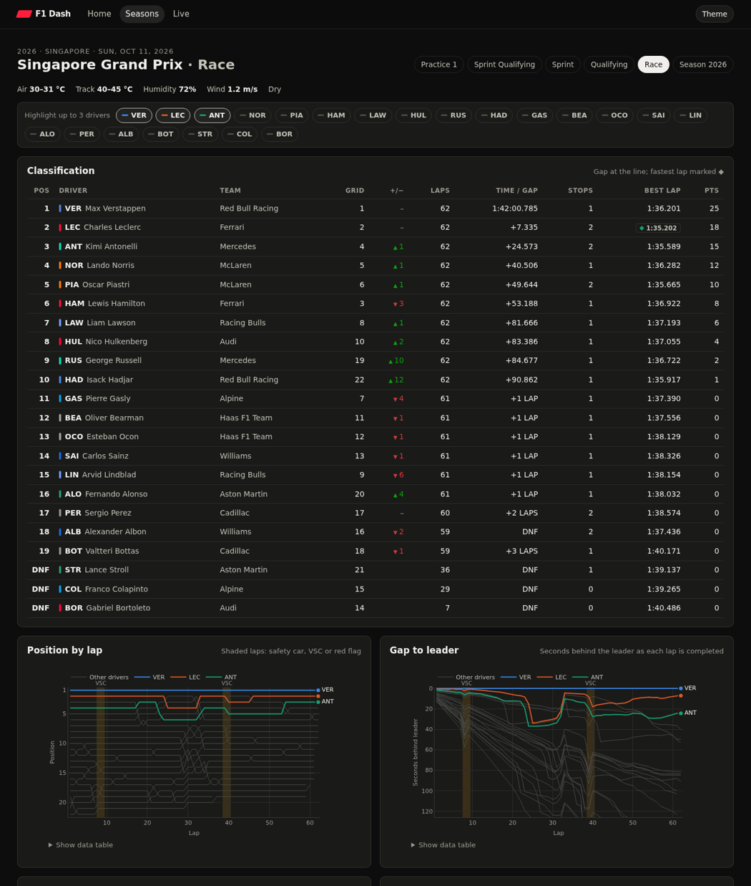
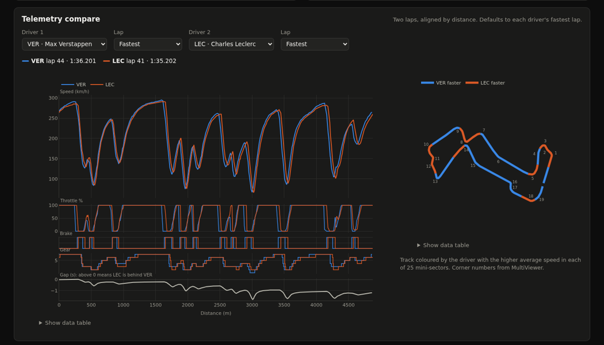
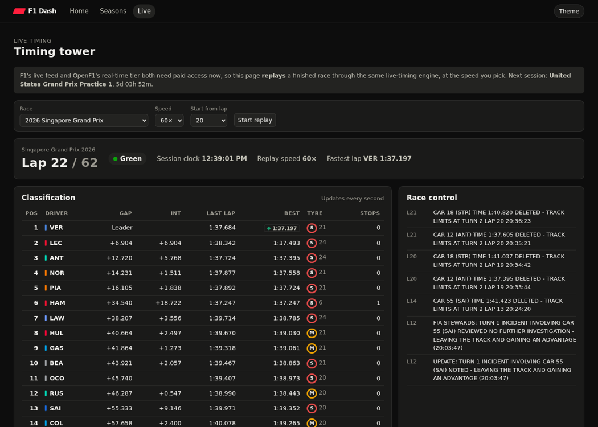

# F1 Dash

A self-hosted Formula 1 dashboard. It covers:
- post-session analysis for every session since 2023
- a season overview with calendar, standings and points progression
- a live-timing tower that replays any finished race over Server-Sent Events



## Features

### Session analysis (`/session/<key>`)
- **Classification:** grid and positions gained, gap at the line, pit stops, fastest lap, points. Qualifying shows Q1, Q2 and Q3.
- **Position by lap and gap to the leader:** safety-car, VSC and red-flag laps are shaded.
- **Tyre strategy:** stints by compound, with a letter on every stint so colour isn't needed.
- **Lap-time distribution:** quick laps only (no lap 1, no out-laps, within 107% of the best).
- **Telemetry compare:** any two laps from any two drivers. Shows speed, throttle, brake, gear and a running time delta, all aligned by distance. A track map shows who was faster in each of 25 mini-sectors, with corner numbers.
- **Race control and weather.**
- **Highlighting:** pick up to three drivers. They keep their colour while you change the selection, and everyone else becomes context.



### Season overview (`/season/<year>`)
The calendar with winners and links to every session, full standings, and points-by-round charts for drivers and constructors. This works for any season back to 1950; session analysis starts in 2023.

### Live timing (`/live`)
The timing tower shows gaps, intervals, last and best laps, tyre and tyre age, pit stops, track status and race-control messages. Updates arrive over SSE via htmx.

F1's live feed and OpenF1's real-time tier both need paid access, so the tower *replays* a finished race at 1–60× speed. It runs through the same `TimingState` engine a real feed would drive, so connecting a real source later only means producing the same events.



### JSON API (`/api/v1/`)
Every chart is backed by a documented read-only endpoint, for example `GET /api/v1/sessions/11388/charts/gaps?focus=3,16`.

## Architecture

```
browser ── htmx (lazy panels, SSE) + Plotly.js (cartesian bundle, vendored)
   │
Flask (gunicorn gthread, 1 worker)
   ├─ web/pages.py   pages + htmx partials
   ├─ web/api.py     /api/v1 JSON
   ├─ web/live.py    /live + SSE stream
   └─ services.py    view models shared by pages and API
        ├─ data/analysis.py  pure pandas transforms (unit-tested)
        ├─ data/live.py      timing state machine + replay
        └─ data/sources.py   OpenF1 · Jolpica · MultiViewer clients
              └─ data/http.py  disk cache (requests-cache/SQLite),
                               per-host token-bucket rate limits,
                               stale-on-error, fail-fast on long 429s,
                               30 s cooldown for a host that is down
```

- **No JS build step.** The browser renders semantic chart data from the server (`static/js/charts.js`), themed from CSS custom properties.
- **Validated colours.** The palette was checked for colour-blind separation and contrast in both light and dark mode. Highlighted drivers use three categorical slots; tyres use their conventional colours plus letters.
- **Caching.** Data for finished sessions never changes, so it is cached forever. Live-ish data expires after 5 minutes and calendars after a day. The free APIs are rate limited (OpenF1 allows about 30 requests a minute), and a cold race page costs about 15 requests.

### Why not FastF1?
Since 15 October 2026, F1's timing archive at `livetiming.formula1.com/static` requires an F1 TV token for every season ([FastF1 #978](https://github.com/theOehrly/Fast-F1/issues/978)). OpenF1 serves the same timing data openly for 2023 onwards. `data/sources.py` keeps the sources behind one interface, so a FastF1 backend can return if that changes.

## Running

```bash
python -m venv .venv && .venv/bin/pip install -e '.[dev]'
.venv/bin/flask --app 'f1dash:create_app()' run --debug     # http://127.0.0.1:5000
```

Docker (one container, cache in a named volume):

```bash
cp .env.example .env   # optional
docker compose up -d --build   # http://localhost:8050 (F1DASH_PORT)
```

| Variable | Default | |
|---|---|---|
| `F1DASH_CACHE_DIR` | `./cache` (`/data/cache` in Docker) | HTTP cache location |
| `F1DASH_LIVE_ENABLED` | `1` | turn off `/live` |
| `F1DASH_MAX_LIVE_STREAMS` | `4` | concurrent SSE replays |
| `F1DASH_OFFLINE` | `0` | serve only from cache |
| `F1DASH_SECRET_KEY` | random | there are no logins or sessions |

## Tests

```bash
.venv/bin/pytest -q && .venv/bin/ruff check . && .venv/bin/ruff format --check .
```

The tests run offline against recorded real responses: the 2026 Singapore GP race and qualifying, four drivers, in `tests/fixtures/upstream.json.gz`. Refresh them with `python scripts/record_fixtures.py`.

## Data and credits
[OpenF1](https://openf1.org), [Jolpica F1](https://github.com/jolpica/jolpica-f1) (the Ergast successor), and the [MultiViewer](https://multiviewer.app) circuit API. This is an unofficial project, not associated with Formula 1. F1, FORMULA ONE and related marks are trademarks of Formula One Licensing B.V.
